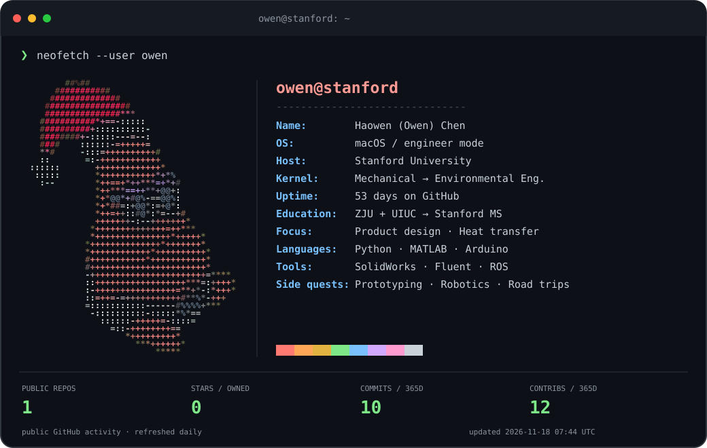

<!-- Layout inspired by https://github.com/Andrew6rant/Andrew6rant. Personalize update_profile.py and avatar.json. Stats show public activity; commits and contributions cover the rolling previous year. Uptime is GitHub account age. -->
